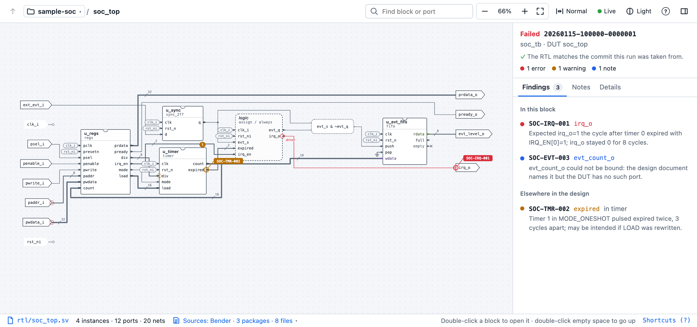
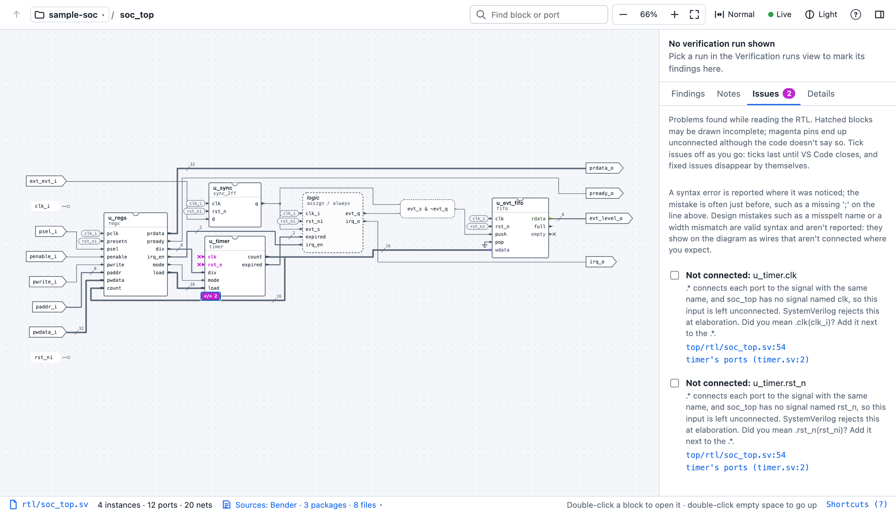

# RTL Diagram

**See your SystemVerilog as a block diagram, and visually track design issues on it, from connection mistakes to verification failures on the ports they name.**

> **Beta.** The diagram, navigation and static checks are ready to use. Showing test failures on the diagram works from reports in one documented format. The script that creates those reports automatically from cocotb, AVL, Verilator or SystemVerilog/UVM test results is not built yet: it is on the [roadmap](docs/ROADMAP.md#reporting). Features that depend on it are marked **(planned)** below. Tested on macOS; feedback from Linux and Windows is welcome. [Report a problem](https://github.com/Hamza-eee/rtl-diagram/issues).

## Who it is for

RTL Diagram is a VS Code extension. It reads your SystemVerilog and draws each module as a block diagram: its ports, the blocks inside it and the wires between them. Blocks and ports link back to their lines in the source. Connectivity comes from [Verible](https://github.com/chipsalliance/verible)'s syntax tree, never from guessing by name, so the same RTL always gives the same diagram.

Here are three ways to use it:

- [RTL designer: draw it as you build](#rtl-designer-draw-it-as-you-build)
- [Design and verification teams: report bugs in visual context](#design-and-verification-teams-report-bugs-in-visual-context)
- [Designers with an agentic verification workflow](#designers-with-an-agentic-verification-workflow)

### RTL designer: draw it as you build

You write RTL with a block diagram already in your head. RTL Diagram draws that diagram from your code, so you can compare what you wrote with what you meant, and see things that are easy to miss in text, such as a port wired to the wrong place. Click a block or a port to jump to its source line.

- **Static checks before compilation, similar to linting but shown on the diagram.** For instance, a `.*` that misses a port, a connection to a port that was renamed or doesn't exist, or an input left unconnected is marked on the pin, with a suggested fix such as *did you mean `.clk_x(clk_i)`?* Files that don't parse mark the blocks they affect. → [Checks](docs/guide/checks.md)
- **Explore unfamiliar designs**, such as third-party IP or a colleague's block, without reading them line by line. Open any block to see what is inside, trace a signal through the design, and jump to its source line. → [Reading and navigating the diagram](docs/guide/diagram.md)
- **Leave notes for yourself** on any port, wire or block as you work. → [Notes](docs/guide/notes.md)
- **The diagram updates live with the RTL.** It is redrawn each time you save an RTL file. You can turn live updates off with the toolbar's Live button to save computing power on large designs. → [Toolbar](docs/guide/diagram.md#toolbar)
- **Open your project files as they are.** Supported inputs are Bender packages, simulator file lists (`.f`) and plain folders of `.sv` / `.v` files. You choose per project; the choice is kept by the extension and never written to your repository. → [Projects and sources](docs/guide/projects-and-sources.md)

### Design and verification teams: report bugs in visual context

When design and verification work together, the diagram is common ground. A verification engineer runs a regression, finds a bug and reports it on the design itself: the failed check appears on the port where it was observed, so the designer sees it in context instead of reading a text log. [How test failures get onto the diagram](#how-test-failures-get-onto-the-diagram) is explained below.

- **Pass findings back and forth on the design.** Either side can leave a note, a question or an issue on a specific port, wire or block, anchored to the exact spot it refers to. Notes are small files saved in the repository, so the team gets them through git, without merge conflicts. → [Notes](docs/guide/notes.md)
- **Report a bug with its reproduction.** A finding includes the command that regenerates the failure, so the designer can reproduce it without asking. → [Verification findings](docs/guide/findings.md)
- **Know whether a report is still valid.** A report records the git commit it was made from. If the RTL has changed since, the report and the affected findings are marked as possibly out of date. → [Does the report still match the RTL?](docs/guide/findings.md#does-the-report-still-match-the-rtl)
- **Use any testbench.** A report is plain JSON in a documented format, so cocotb, AVL, Verilator, SystemVerilog/UVM or your own scripts can all produce one. **(The script that creates reports from their results is planned.)** → [Verification report format](docs/verification-report-format.md)

### Designers with an agentic verification workflow

If you already deploy an agentic harness for verification, it can report the bugs it finds on the block diagram instead of in a text log. The diagram narrows down where to look and takes you straight to the source, so you spend your time on the part that matters.

- **See each failed check where it was observed.** The finding is marked on its port, with the message, the signal values, the test and the requirement it violates. Blocks above it show a count, so you can find it from the top. → [Verification findings](docs/guide/findings.md)
- **Go from the symptom to the code that drives it.** Each finding links to the port's declaration and to the statements that drive the signal, as places to look first. They are candidates, not a diagnosis. → [Verification findings](docs/guide/findings.md)
- **Reproduce the exact failure** with the command each finding carries, as described in [the previous section](#design-and-verification-teams-report-bugs-in-visual-context).

**Status:** showing a report's findings on the diagram works today, and an agent can already write reports in this extension's format by following its [documentation](docs/verification-report-format.md). The script that creates the reports automatically, for an agent or for any testbench, is **(planned)**.

## How test failures get onto the diagram

The second and third uses above rely on verification reports. Here is how they work.

1. You run tests on your design: a regression with a testbench, written for example in cocotb, AVL, Verilator or SystemVerilog/UVM.
2. A script turns the test results into a **verification report**, automatically. A report is a folder with two JSON files. `run.json` says when the tests ran, on which git commit and for which design module. `findings.sarif` lists every failed check, in [SARIF](https://sarifweb.azurewebsites.net/), a standard format for tool results. Each failed check is called a **finding**. It names the signal where the problem was seen, and carries what was expected and observed, the test name, the random seed, the signal values and the command that reproduces the failure.
3. The report's format is standardized, so RTL Diagram can present any report that follows it, whichever testbench produced the results. It reads the folder and marks every finding on the port it names.

**What exists today:** the extension reads this format, and the format is [documented](docs/verification-report-format.md), with complete examples in [`test-fixtures/sample-soc`](https://github.com/Hamza-eee/rtl-diagram/tree/main/test-fixtures/sample-soc). Reports can be written by hand, by your own script, or by an AI agent following the format.

**What is planned:** a report script that creates the reports from cocotb, AVL, Verilator and SystemVerilog/UVM test results, and ready-made instructions for agentic workflows. See the [roadmap](docs/ROADMAP.md#reporting).

## Limitations

- **Similar to linting, but not a linter.** The checks cover what stops the RTL from being parsed or connected, not coding-style or other lint rules. For those, use `verible-verilog-lint`, which comes with the Verible install this extension already needs.
- **No elaboration.** Parameters use their default values, and generate loops are drawn once instead of expanded.
- **Interfaces and modports** are drawn as plain ports, and state machines inside a module are not drawn.
- **Not a synthesis schematic.** It shows modules, instances and the wires between them, not gates.

The full list is in [Troubleshooting and limitations](docs/guide/troubleshooting.md#limitations).

## Get started

1. **Install Verible**, the open-source SystemVerilog parser this extension uses, so that `verible-verilog-syntax` is on your `PATH`:
   - macOS: `brew install verible`;
   - Linux and Windows: download a [release](https://github.com/chipsalliance/verible/releases) and add its `bin` folder to your `PATH`, or set `rtlDiagram.veriblePath` to the full path.

   Check with `verible-verilog-syntax --version`. Tested with Verible v0.0-3946.
2. **Install the extension.** Download the `.vsix` file from the [releases page](https://github.com/Hamza-eee/rtl-diagram/releases), then in VS Code run **Extensions: Install from VSIX…** (VS Code 1.90 or later).
3. **Open a folder with your RTL**, click the **RTL Diagram** icon in the activity bar, and click a module in the **Hierarchy** list in the side bar (it shows each module and the blocks inside it).

Nothing else is needed: no simulator, no licence server, no Python. git is optional; it names note authors and tells whether a verification report still matches the RTL. Press `?` at the top bar to check keyboard shortcuts.

## Extension runs completely locally

The extension never connects to the network and collects no telemetry. It reads your files, writes only note files, and runs only Verible and local git commands. [What it does, and how to check it yourself](docs/guide/privacy.md).

## Documentation

| Guide | |
|---|---|
| [Reading and navigating the diagram](docs/guide/diagram.md) | controls, toolbar, what each symbol means |
| [Checks](docs/guide/checks.md) | syntax errors, missing modules, unconnected pins, what isn't checked |
| [Projects and sources](docs/guide/projects-and-sources.md) | folders with several projects, Bender, file lists, choosing sources |
| [Verification findings](docs/guide/findings.md) | verification reports, findings on the diagram, reproducing a failure |
| [Notes](docs/guide/notes.md) | notes, questions and issues shared through git |
| [Settings and commands](docs/guide/settings.md) | every setting and command |
| [Offline, no telemetry](docs/guide/privacy.md) | what it reads, writes and runs |
| [Troubleshooting and limitations](docs/guide/troubleshooting.md) | common problems, known limits |
| [Verification report format](docs/verification-report-format.md) | the standard format a report script produces and the extension reads |

For building from source and how it works inside, see [Development](docs/DEVELOPMENT.md), [Architecture](docs/ARCHITECTURE.md) and the [Roadmap](docs/ROADMAP.md). Changes are listed in the [changelog](CHANGELOG.md).

## Feedback

Bug reports and ideas are welcome as [GitHub issues](https://github.com/Hamza-eee/rtl-diagram/issues). Pull requests are not accepted.

## Licence and credits

Created by [Hamza-eee](https://github.com/Hamza-eee). Licensed under the [Apache License 2.0](LICENSE): you may use, change and share it, keeping the [NOTICE](NOTICE). If you build on it, please credit this project.

Built on [Verible](https://github.com/chipsalliance/verible) (CHIPS Alliance) for parsing, and the [Eclipse Layout Kernel](https://github.com/eclipse/elk) via [elkjs](https://github.com/kieler/elkjs) for layout. It reads the [Bender](https://github.com/pulp-platform/bender) package format, used by the PULP Platform. Third-party licences are in [THIRD_PARTY_NOTICES.md](THIRD_PARTY_NOTICES.md).
