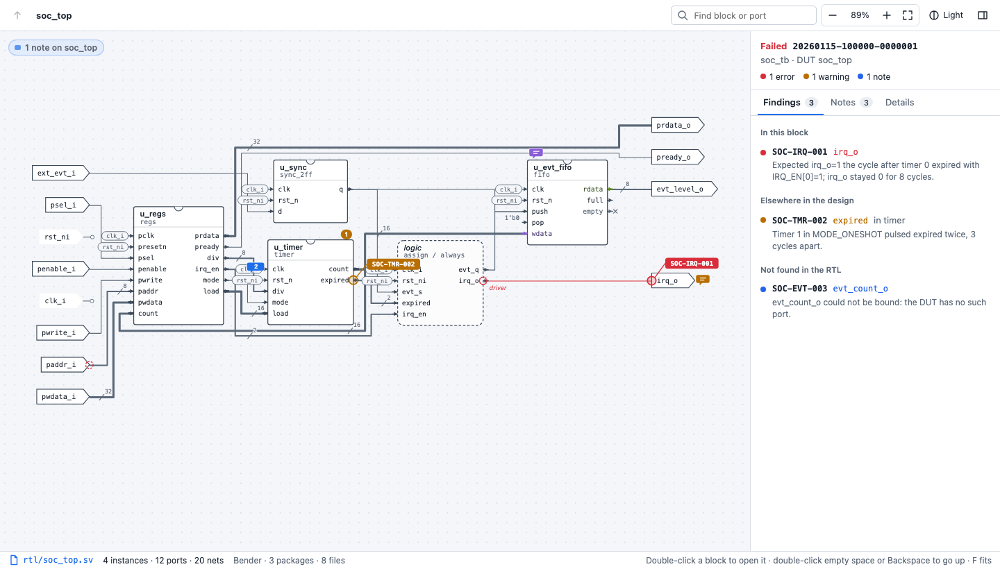
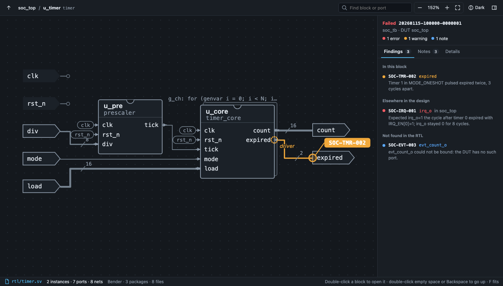

# RTL Diagram

**Block diagrams of your SystemVerilog, with verification findings marked on the ports they name.**

RTL Diagram draws your design hierarchy straight from the RTL, so designers and verification engineers can look at the same picture. Open a block to see what's inside. When a verification run fails, the port that misbehaved is flagged on the diagram, with links to its declaration and to the code that drives it.

## Features

- **Diagrams from the RTL itself.** Every module is drawn with its ports, child instances and the nets between them. Port directions show as schematic arrows, buses carry their width, and open or tied pins are marked.
- **Navigate the hierarchy.** Double-click a block to open it, double-click empty space to go back up, zoom and pan freely, or jump to any block or port with Find.
- **Findings on the diagram.** Load a verification run and each finding appears as a probe on the port it names. The side panel shows the message, the signal values, the test and seed, a reproduce command and the requirement text. From there you can jump to the port declaration and to every statement that drives it.
- **Notes for the team.** Leave a note, question or issue on any port, wire or block. Notes are saved as small files next to your code, so the rest of the team sees them after a pull.
- **Deterministic.** Connectivity comes from [Verible](https://github.com/chipsalliance/verible)'s syntax tree, never from naming guesses, so the same RTL always gives the same diagram.
- **Works with how you organise RTL.** It reads [Bender](https://github.com/pulp-platform/bender) packages directly, as well as simulator filelists (`.f`) or plain folders of `.sv` / `.v` files.

## Quick start

1. Install Verible so that `verible-verilog-syntax` is on your `PATH`:
   - macOS: `brew install verible`
   - Linux / Windows: download a binary from the [Verible releases](https://github.com/chipsalliance/verible/releases)

   If it lives somewhere else, set `rtlDiagram.veriblePath`.
2. Install the extension. Until it is on the Marketplace, use **Extensions: Install from VSIX…** with a `.vsix` built as described in [Building from source](docs/DEVELOPMENT.md).
3. Open a folder with your RTL and click the **RTL Diagram** icon in the activity bar.
4. Click a module in **Hierarchy** to open its diagram.

If you opened a parent folder holding several projects, the extension offers to pick one. You can change it any time with **RTL Diagram: Choose Project Folder…** or the status bar.

## Using the diagram

| To | Do |
|---|---|
| Open a block | Double-click it, or select it and press Enter |
| Go up one level | Double-click empty space, press Backspace, or use the breadcrumbs |
| Trace a net | Click a pin, wire or net label |
| See a block's parameters and links | Click the block; the **Details** tab has *Go to instance* and *Go to definition* |
| Fit, zoom | `F`, `+`, `-`, `0` for 100%, or the mouse wheel / trackpad pinch |
| Find a block or port | `/`, then type |
| Switch theme | The toolbar button cycles Auto, Light and Dark |
| Pause redrawing | The toolbar's **Live** button. While paused, the diagram stays as drawn and a banner lists the RTL files saved since, with *Refresh* |
| Add a note | Right-click a port, pin, wire, block or empty space |

### Reading the diagram

| You see | It means |
|---|---|
| Arrow-shaped terminals | the module's own ports: inputs on the left pointing in, outputs on the right pointing out, inouts double-headed |
| Arrowheads on pin stubs | the direction of each instance pin |
| Block with a notch | a child instance, with its module name under the instance name |
| Dashed rounded block | the module's own `assign` / `always` code |
| Stacked outline and a header above a block | the instance is inside a `generate` construct |
| Wire thickness, slash with a number | 1 bit, 2–8 bits, more than 8 bits; the bus width |
| `×` at a pin, a value at a pin | the pin is left open, or tied to a constant |
| Small rounded tag at a pin | a clock, reset or high fan-out net drawn as a label instead of a wire |
| Coloured probe with a rule ID | where a verification finding was observed; a dotted ring marks the statements that directly drive that signal (candidates, not a diagnosis) |
| Count badge on a block | findings on that instance or somewhere inside it |
| Speech bubble | one or more notes |

A net is drawn only if the module declares it as a port, net or variable. Names are used for display choices only (which nets become labels, pin colours), never for connectivity.

## Verification findings

The **Verification runs** view lists every run folder it finds (by default `**/reports/*/run.json`). Click a run to show its findings:

- each port where the testbench **observed** a problem gets a probe tagged with the rule ID, and the blocks above it get a count badge. The probe marks the symptom, not the cause; the statements that directly drive the signal are marked as candidates to inspect;
- the **Findings** tab groups findings into *in this block*, *elsewhere* and *not found in the RTL*, the last with the reason;
- findings also appear in the Problems panel, on the port declaration;
- rules with no findings are listed as *checked, clean*.

Runs are plain files: a `run.json` manifest and a SARIF 2.1.0 `findings.sarif`. Any testbench, script or agent can write them. The format is described in [docs/run-format.md](docs/run-format.md), and `test-fixtures/sample-soc` has complete examples.

**Is the RTL still what the run tested?** A run records the git commit it was taken from. The extension compares that commit with your working tree and says so in the run header: *RTL matches*, *changed since this run* (listing the RTL files that differ), or why it can't tell (the commit isn't in this repository, or the run had uncommitted changes). Findings in a changed file carry a warning on their card and in the Problems panel. Without git, file times are compared with the run's finish time.

**Type in terminal** on a finding types its reproduce command into a new terminal without running it. Commands containing line breaks or control characters are refused; copy those instead.

## Notes

Right-click a port, pin, wire, block or empty space and choose **Add note**. Pick **Note**, **Question** or **Issue**, write it, and optionally tick **Only this instance**.

- A note on a module's port shows wherever that module is used, unless it is pinned to one instance.
- Click a speech bubble to open the **Notes** tab, where notes can be edited, resolved, reopened, deleted or jumped to.
- Each note is a JSON file in `.rtl-notes/` inside the project folder. Commit that folder to share notes. With one file per note, two people adding notes never get a merge conflict.
- The author is taken from your git `user.name`.
- If the port or instance a note points at disappears from the RTL, the note is listed as **Detached** with the reason. It is never dropped.

## Where the RTL comes from

The extension reads from the project folder you chose, or from the whole workspace if you didn't choose one. In `auto` mode the first of these that exists is used:

1. **Bender.** Every `Bender.yml` is read directly: sources in order, globs expanded, `path` dependencies followed. Source groups with a `target:` are included only when the expression holds for `rtlDiagram.benderTargets`. The default is no active targets, which gives plain RTL: `test`, `simulation` and technology-specific groups are left out. `bender` itself is never run, so nothing is written to your repository. Git dependencies resolve if they are already checked out under `.bender/`.
2. **Filelists** listed in `rtlDiagram.filelists`, with support for `-f` nesting, `+incdir+`, `-v` and `-y`.
3. **Include glob**, `rtlDiagram.include` (default `**/*.{sv,v}`).

Testbench folders are excluded by default through `rtlDiagram.exclude`. Click the status bar to change the project; **RTL Diagram: Show Source Files** lists the files in use.

## Settings

| Setting | Default | Description |
|---|---|---|
| `rtlDiagram.projectFolder` | *(empty)* | Folder to read RTL, runs and notes from. Empty: the folder chosen with *Choose Project Folder…*, or the whole workspace. |
| `rtlDiagram.liveUpdate` | `true` | Redraw when RTL files are saved. Off: keep the diagram and list changed files. |
| `rtlDiagram.veriblePath` | `verible-verilog-syntax` | Verible syntax tool. |
| `rtlDiagram.sourceMode` | `auto` | `auto`, `bender`, `filelist` or `glob`. |
| `rtlDiagram.benderRoots` | `[]` | Only use these folders' `Bender.yml` as roots. |
| `rtlDiagram.benderTargets` | `[]` | Active Bender targets, e.g. `["synthesis", "xilinx"]`. |
| `rtlDiagram.filelists` | `[]` | `.f` filelists to read. |
| `rtlDiagram.include` | `**/*.{sv,v}` | Glob used when there is no Bender.yml or filelist. |
| `rtlDiagram.exclude` | testbench folders | Globs never read as RTL. |
| `rtlDiagram.runsGlob` | `**/reports/*/run.json` | Where verification runs are found. |
| `rtlDiagram.netLabels.pattern` | clocks and resets | Nets whose name matches are drawn as labels. Empty disables. |
| `rtlDiagram.netLabels.minLoads` | `6` | Nets with at least this many loads are drawn as labels. `0` disables. |
| `rtlDiagram.notesFolder` | `.rtl-notes` | Where notes are stored, inside the project folder. |
| `rtlDiagram.theme` | `auto` | `auto` follows VS Code; `light` or `dark` fixes the diagram theme. |
| `rtlDiagram.colors.block`, `.wire`, `.error`, `.warning`, `.note` | theme | CSS colours for blocks, wires and finding levels. |
| `rtlDiagram.colors.portGroups` | `{}` | Pin colour per name prefix, e.g. `{ "s_axi_aw": "#1565C0" }`. |

## Commands

| Command | |
|---|---|
| RTL Diagram: Open Diagram | Open the diagram panel. |
| RTL Diagram: Choose Project Folder… | Pick the folder to read from. |
| RTL Diagram: Choose Top Module… | Pick which top module the diagram starts from. |
| RTL Diagram: Open Run Folder… | Load a run directory from anywhere on disk. |
| RTL Diagram: Clear Active Run | Hide findings. |
| RTL Diagram: Toggle Live Updates | Pause or resume redrawing on save. |
| RTL Diagram: Rescan Sources and Runs | Re-read everything. |
| RTL Diagram: Show Source Files | List the RTL files in use. |

## Troubleshooting

- **"Verible not found".** Install Verible or set `rtlDiagram.veriblePath` to the full path of `verible-verilog-syntax`.
- **Modules from several projects are mixed.** Choose a project folder (status bar or *Choose Project Folder…*).
- **A module or a testbench file is missing.** Check *Show Source Files*. Testbench folders are excluded on purpose; adjust `rtlDiagram.exclude`, or `rtlDiagram.benderTargets` for Bender target groups.
- **A block is dashed with "not in sources".** The instantiated module isn't in the files read, often a vendor primitive or a missing Bender dependency. Run `bender checkout` for git dependencies.
- **A finding says "Not found in the RTL".** The card shows why: the DUT module isn't parsed, an instance on its path doesn't exist, or the port name differs from the RTL.
- **Source issues** (syntax errors, duplicate modules, unreadable manifests) are listed at the top of the Hierarchy view.

## Limitations

- Parameters are evaluated from their defaults; per-instance overrides don't change widths yet, and generate loops are drawn once with their header rather than expanded.
- Interfaces and modports are drawn as plain ports.
- State machines inside a module are not drawn.

See the [roadmap](docs/ROADMAP.md) for what's planned.

## Feedback

Bug reports and ideas are welcome as GitHub issues. Pull requests are not accepted.

To build the extension yourself, see [Building from source](docs/DEVELOPMENT.md). The design is explained in [docs/ARCHITECTURE.md](docs/ARCHITECTURE.md).
