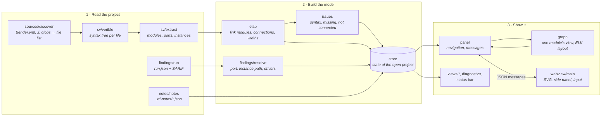

# Architecture

RTL Diagram has two halves:
- the **extension host** (Node.js and the VS Code API) reads files and builds plain data;
- the **webview** (a browser page inside VS Code) draws that data.

They talk only through JSON messages.

## How data flows

1. **Read.** The store asks `sources/discover` for the project's RTL files, has Verible parse each one (cached by modification time), and extracts modules from the trees. Runs and notes are plain files, read as they are.
2. **Model.** `elab` links modules into a design: it resolves connections, evaluates port widths and finds the top modules. `issues` collects what went wrong. `findings/resolve` maps each finding to a port and its drivers.
3. **Show.** For the module being viewed, `graph` builds the nodes, pins and nets and lays them out with ELK. `panel` sends the result to the webview and handles what the user does there.

## Extension host

| File | Role |
|---|---|
| `extension.ts` | Activation: trees, commands, diagnostics, status bar, file watchers (scoped to the project folders). |
| `store.ts` | State of the open project: project choice, per-project sources, parsed design, issues, runs, active run, notes, live/paused. Rescans go through `util/serial.ts` so they never overlap. |
| `sources/discover.ts` | Picks the RTL file list: Bender, then filelists, then the include glob, minus exclusions. |
| `sources/bender.ts` | Reads `Bender.yml` without running bender: ordered sources, globs, path dependencies, target expressions. |
| `sources/filelist.ts` | Reads `.f` filelists. |
| `sv/verible.ts` | Runs `verible-verilog-syntax --export_json --printtree`. |
| `sv/extract.ts` | Walks the syntax tree: modules, ports, parameters, instances (with generate scopes and unique keys), drivers and reads. |
| `elab.ts` | Links modules into a design: positional and `.*` connections, instance-output drivers, port widths, tops, hierarchical paths. |
| `issues.ts` | Source issues (syntax errors, duplicate and missing modules, unconnected pins with suggested fixes) and where they show in a view. |
| `findings/run.ts` | Loads and checks a run directory (`run.json`, `findings.sarif`). |
| `findings/resolve.ts` | Maps a finding's signal names to the DUT module, instance path, port declaration and drivers. |
| `findings/markers.ts` | Decides where findings appear in a given view, by instance path. |
| `findings/freshness.ts` | Compares the RTL with a run's git commit (local git, read-only). |
| `notes/notes.ts` | Note files (validated, writes confined to the notes folder), anchors, detached detection, placement. |
| `graph.ts` | One module's view: ports, instances, the logic block, expression boxes, nets, net labels, tied pins; ELK layout. |
| `panel.ts` | The diagram panel: navigation state, messages to and from the webview, finding details, note actions. |
| `views/*.ts` | The Hierarchy and Verification reports trees. |
| `util/` | Project detection, glob expansion, the serial rescan queue. |

Everything except `extension.ts`, `store.ts`, `panel.ts` and `views/` is free of the VS Code API, which is what makes it unit-testable.

## Key decisions

- **Verible's syntax tree, not a regex or a home-grown parser.** It handles ANSI and non-ANSI headers, all connection forms and generate constructs, and gives exact source positions. The cost is an external binary.
- **No elaboration.** Parameters are evaluated from defaults for widths only; generate loops are drawn once. Full elaboration would need a real SystemVerilog front end (e.g. slang).
- **Nets only if declared.** Avoids guessing whether an identifier is a signal, parameter or enum constant.
- **Expression boxes.** A port connection with logic in it (`.push(a & ~b)`) becomes one box feeding the pin, so a pin never shows several drivers. Plain names and part-selects stay direct wires.
- **Instance keys.** Instance names can repeat across if/else generate branches, so each instance gets a key unique in its module (`u_x`, `u_x#2`). Keys are used for node ids, navigation paths and drivers. They depend on source order, so reordering same-named instances changes which one is `#2`; notes pinned to such an instance can then detach (they are listed as detached, never silently moved).
- **Findings placed by instance path.** A finding on `tb.dut.u_tx.q` marks `u_tx` only. If the DUT appears more than once under the viewed top, placement falls back to module matching and the UI says so.
- **Layout in the host.** ELK runs in the extension host, so layout is testable and the webview only draws. Fixed port positions keep pins on the drawn pitch; a fixed random seed keeps layout deterministic.
- **Notes as one file per note.** Shared through git without merge conflicts; anchored to a module, optionally to one instance path.
- **Build stamp.** esbuild compiles the same stamp into the host and the webview. After an install, VS Code keeps the old host running until a reload while the panel loads the new script; on a mismatch the webview asks for a reload.

## Webview

`webview/main.ts` draws the view as SVG, with edges, nodes, finding probes, issue marks and note bubbles in separate layers. The side panel (Findings, Notes, Issues, Details) is HTML. The webview keeps only display state (transform, selection, open tab, note drafts) and asks the host for everything else.

Styles are in `media/diagram.css`. *Auto* uses VS Code theme variables, *Light* and *Dark* are fixed palettes, and user colours from settings override both. The Content Security Policy allows only the bundled script (with a nonce) and the extension's stylesheet.

## Messages

| Webview → host | Purpose |
|---|---|
| `ready` | Webview loaded; the host sends theme and view |
| `drill`, `goto`, `setTop` | Navigate |
| `open`, `openFile`, `reveal`, `openSetting` | Open a source location, file or setting |
| `showFinding`, `selectFinding` | Go to / show a finding |
| `addNote`, `updateNote`, `deleteNote`, `gotoNote` | Notes |
| `checkIssue`, `uncheckIssues` | The Issues checklist |
| `setProject`, `browseProject`, `chooseProject`, `configureSources` | Projects and sources |
| `setSpacing`, `setLive`, `setTheme`, `refresh` | Toolbar |
| `copy`, `runInTerminal` | Utilities |

| Host → webview | Purpose |
|---|---|
| `view` | Laid-out graph, breadcrumbs, findings, markers, notes, issues, project and toolbar state |
| `detail` | Full finding card |
| `live` | Live/paused state and files changed while paused |
| `theme` | Theme mode and colours |
| `empty` | Nothing to show: choosing a project, scanning, an error, no modules |
